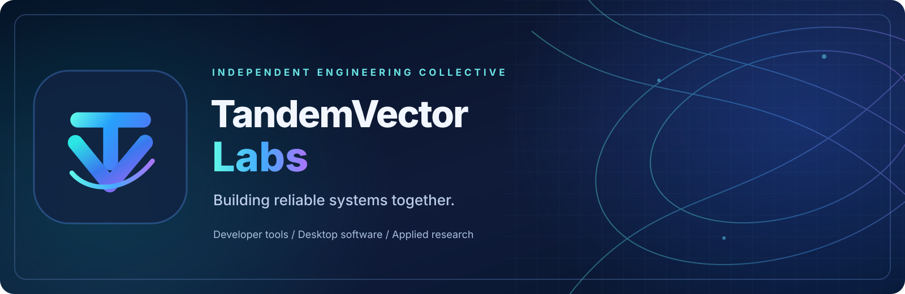
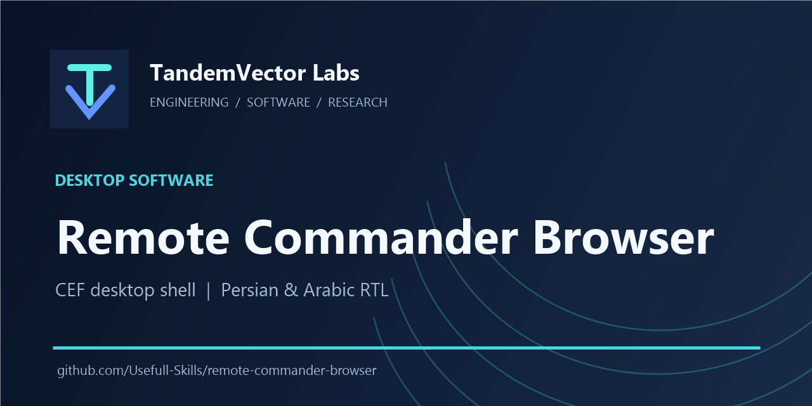
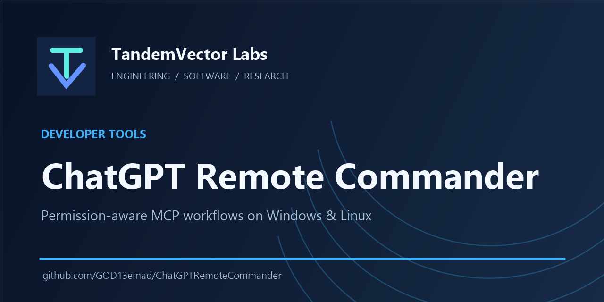
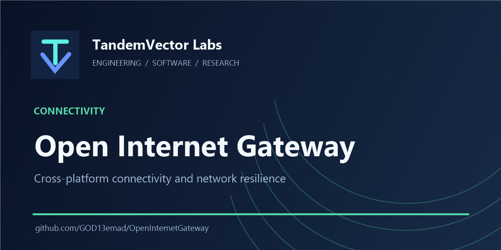
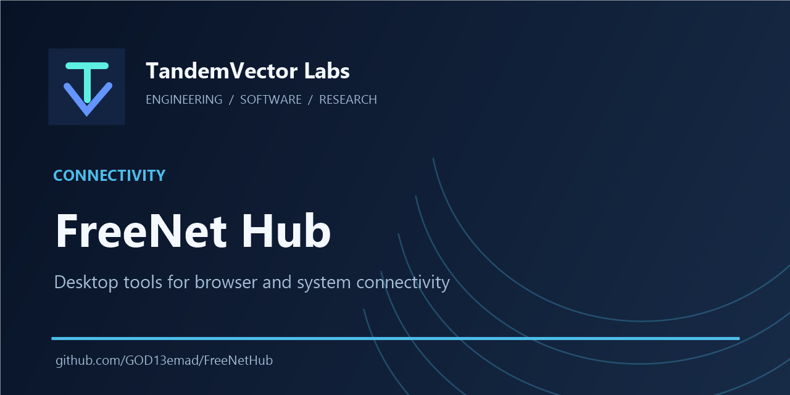

<!-- Public TandemVector Labs profile; no private projects or unreleased artwork. -->

  

  <a href="https://github.com/Usefull-Skills/.github/blob/main/PROJECT_CATALOG.md"><strong>Project directory</strong></a> &nbsp;·&nbsp;
  <a href="https://github.com/Usefull-Skills/.github/blob/main/CONTRIBUTING.md">Contribute</a> &nbsp;·&nbsp;
  <a href="https://github.com/Usefull-Skills/.github/blob/main/GOVERNANCE.md">Governance</a> &nbsp;·&nbsp;
  <a href="https://github.com/Usefull-Skills/.github/blob/main/SECURITY.md">Security</a> &nbsp;·&nbsp;
  <a href="https://github.com/Usefull-Skills/.github/blob/main/SUPPORT.md">Support</a>

## About TandemVector Labs

**A shared engineering and software R&D collective — building reliable systems together.**

TandemVector Labs is a **jointly operated technical collective**, not the personal brand of either contributor. Our work connects developer tools, applied engineering, research workflows, secure desktop software, and connectivity systems. We prioritize **traceable changes, clear limitations, security-conscious design, and reproducible releases**.

> **Brand:** TandemVector Labs · **Current GitHub namespace:** `Usefull-Skills`. A possible future handle change is not yet complete. This is a project and collaboration identity, **not a claim of registered company status or trademark clearance**. Each repository has its own licensing and release maturity.

### Areas of work

| Developer tooling | Desktop experiences | Connectivity and research |
| :--- | :--- | :--- |
| Automation workflows, reproducible utilities and engineering infrastructure | Accessible interfaces, desktop software and practical user-focused tools | Reliable networking, technical experimentation and applied R&amp;D |

### Featured public projects

| | |
| :--- | :--- |
|  |  |
| **[Remote Commander Browser](https://github.com/Usefull-Skills/remote-commander-browser)** — organization-origin project; candidate-stage software | **[ChatGPT Remote Commander](https://github.com/Usefull-Skills/ChatGPTRemoteCommander)** — organization fork; [personal upstream and releases](https://github.com/GOD13emad/ChatGPTRemoteCommander) |
|  |  |
| **[Open Internet Gateway](https://github.com/Usefull-Skills/OpenInternetGateway)** — organization fork; [personal upstream and releases](https://github.com/GOD13emad/OpenInternetGateway) | **[FreeNet Hub](https://github.com/Usefull-Skills/FreeNetHub)** — organization fork; [personal upstream and releases](https://github.com/GOD13emad/FreeNetHub) |

*These visual cards are a navigation aid, not GitHub pinned-repository settings or an indication of release acceptance. See each project's README and the directory below for current status and attribution.*

## Explore the work

Browse the [complete public project directory](https://github.com/Usefull-Skills/.github/blob/main/PROJECT_CATALOG.md) for verified upstream links, release locations, issue reporting and status boundaries.

### Original projects hosted in this organization

| Project | Focus | Status |
| --- | --- | --- |
| **[Remote Commander Browser](https://github.com/Usefull-Skills/remote-commander-browser)** | Unofficial Chromium Embedded Framework (CEF) desktop browser shell, with native tabs, Persian/Arabic RTL support, and narrowly scoped permissions | **Candidate-stage**; refer to its own README and releases for verified details |
| **[Appearance Studio Core](https://github.com/Usefull-Skills/AppearanceStudio-Core)** | Linux/GNOME appearance tooling, Theme Packs and transactional rollback; written by Dr. Emadoddin under the distinct **Arclenor Technologies** product identity | **v0.9.0 release candidate**, GNOME 50 live acceptance still pending; no shipped Windows version claimed |

Remote Commander Browser is a **separate project** from the Remote Commander MCP server. It is not an official OpenAI or ChatGPT desktop application.

### Public forks of contributor-owned projects

These are **GitHub forks inside this organization**. The personal repositories remain the **upstream sources**; they have not been transferred or deleted. The forked default-branch commit SHAs were checked against their upstream counterparts on 2026-10-14.

| Organization repository | Original upstream | Focus |
| --- | --- | --- |
| [ChatGPT Remote Commander](https://github.com/Usefull-Skills/ChatGPTRemoteCommander) | [Source](https://github.com/GOD13emad/ChatGPTRemoteCommander) | Permission-aware Windows/Linux MCP and project workflows |
| [Direct Internet Method](https://github.com/Usefull-Skills/DirectInternetMethod) | [Source](https://github.com/GOD13emad/DirectInternetMethod) | Windows/Linux direct-connect networking |
| [FreeNet Hub](https://github.com/Usefull-Skills/FreeNetHub) | [Source](https://github.com/GOD13emad/FreeNetHub) | Desktop connectivity tools |
| [Open Internet Gateway](https://github.com/Usefull-Skills/OpenInternetGateway) | [Source](https://github.com/GOD13emad/OpenInternetGateway) | Cross-platform, self-healing network gateway |
| [Taskbar Monitor Enhanced](https://github.com/Usefull-Skills/TaskbarMonitorEnhanced) | [Source](https://github.com/GOD13emad/TaskbarMonitorEnhanced) | Windows taskbar and hardware monitoring |
| [Persian Word Agent](https://github.com/Usefull-Skills/PersianWordAgent) | [Source](https://github.com/GOD13emad/PersianWordAgent) | Persian-language Microsoft Word assistance |

**Important:** Forks preserve Git provenance but are not a full transfer of GitHub Issues, pull requests, releases, Wikis, repository settings, or CI secrets. Fork branches are not continuously synchronized by this profile; consult the upstream project for authoritative releases.

### Legacy third-party fork lineage

These are older **forks of third-party upstream projects**, not products originally authored by this organization:

- [LTEMonitor in this organization](https://github.com/Usefull-Skills/LTEMonitor) ← [personal fork](https://github.com/GOD13emad/LTEMonitor) ← [original upstream](https://github.com/kruzer/LTEMonitor)
- [WSAGAScript in this organization](https://github.com/Usefull-Skills/WSAGAScript) ← [personal fork](https://github.com/GOD13emad/WSAGAScript) ← [original upstream](https://github.com/WSA-Community/WSAGAScript)

Their own licenses, credits, maturity, and upstream support policies remain authoritative. Presence in the organization does **not** imply active maintenance.

The complete public project list, including legacy work and forks, is available at [the contributor's GitHub profile](https://github.com/GOD13emad?tab=repositories). **Private repositories are intentionally not listed.**

## Joint stewardship

This GitHub portfolio has two organization owners. The public organization identity is shared; individual projects retain their documented authorship and licensing. Governance and contribution standards are published in the [organization policy repository](https://github.com/Usefull-Skills/.github), including [Governance](https://github.com/Usefull-Skills/.github/blob/main/GOVERNANCE.md), [Security](https://github.com/Usefull-Skills/.github/blob/main/SECURITY.md), and [Contributing](https://github.com/Usefull-Skills/.github/blob/main/CONTRIBUTING.md).

## How we work

- **Evidence before claims:** build success, runtime verification, user acceptance, and release qualification are distinct gates.
- **Security and privacy:** never include access tokens, credentials, browser sessions, private datasets, or personal information in issues or commits.
- **Reproducibility:** document dependencies, supported platforms, commands, checks, and known limitations.
- **Preserve provenance:** retain commit history, original authorship, licensing, and upstream credits when projects are imported or mirrored.
- **Scoped ownership:** changes, feature requests, bugs, and security reports belong in the relevant project repository.

## Contributing and reporting issues

1. Select the relevant repository and read its `README`, contribution guidelines, and license/notice files.
2. For a bug, provide the exact version, operating system, steps to reproduce, expected behavior, actual behavior, and sanitized logs.
3. For security-sensitive findings, follow that repository's `SECURITY.md` instructions. **Do not publish exploit details or secrets in public issues.**
4. Submit targeted pull requests with test evidence and a rollback path for changes that affect existing behavior.

**No organization-wide release or compatibility guarantee is implied.** Review the current status of each repository before installing or deploying it.

## فارسی

این مجموعه برای معرفی و توسعه ابزارهای مهندسی، نرم‌افزارهای کاربردی و گردش‌کارهای فنیِ قابل بازتولید ایجاد شده است. هر پروژه مستندات، سطح بلوغ، شرایط مجوز و الزامات امنیتی مخصوص خود را دارد.

هشت پروژه عمومی در قالب **Fork** به سازمان اضافه شده‌اند. مخازن شخصی همچنان مرجع اصلی هستند و نسخه‌های Fork لزوماً همگام‌سازی خودکار، تنظیمات CI یا انتشارهای اصلی را ندارند. **مخازن خصوصی بدون بررسی مجوز و سطح دسترسی منتشر نمی‌شوند.**

## Independence and trademarks

Projects here are independent unless a specific repository expressly states otherwise. References to ChatGPT, OpenAI, CEF, Windows, or other products identify technologies or compatibility targets; they do **not** imply endorsement, partnership, or official status. Third-party trademarks and licenses belong to their respective owners.
